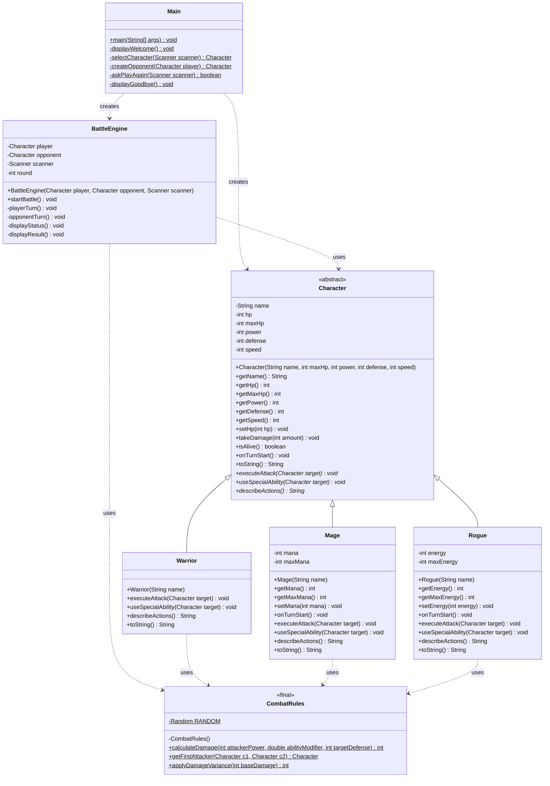

# Java game template

This repository contains a Java strater template with gradle.

## Requirements

- Java 25+
- Gradle 9+
- An IDE (like IntelliJ, Eclipse or even VSCode with Java extension)

Tested only under linux.

## Usage

Run `./gradlew run` to start the program.

If you write tests, you can run `./gradlew test` to run them.

## Class diagramExpand commentComment on line R19Resolved

Legend: `-` private, `+` public, `#` protected, `$` static, `*` abstract (italic).

+